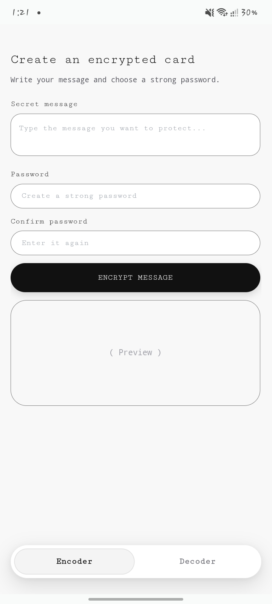
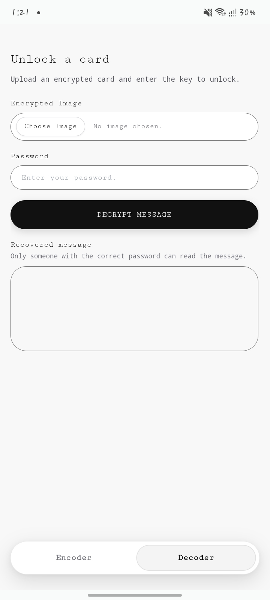
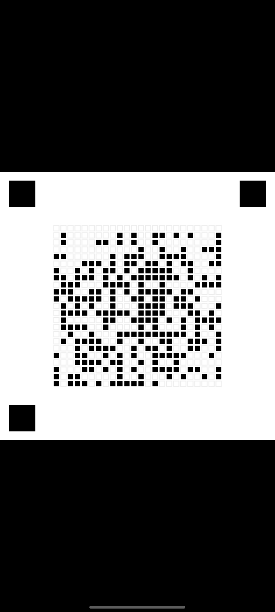

# Eeko — Private Messages. Picture Cards.
Your message. Your secret. Your card.

# ⬇️ Download Eeko for Android
https://github.com/chiragcreates/Eeko/releases/latest

Free · Android · Offline-focused
Eeko is an offline-focused Android app that encrypts text and packages the encrypted data into PNG image cards.

#  Screenshots

Encode

Decode

Example Card

# ✳ Why Eeko?
- 🔐 Password-protected messages — encrypt text using a password.
- 🖼️ PNG message cards — save encrypted data inside an image card.
- 📴 Offline-focused — designed to work without an internet connection.
- 🔄 Import and export — use Android's file picker to open and save cards.

# ↗ How it works
1. Write your message.
2. Encrypt it with a password.
3. Save the resulting PNG card.
4. Open the card in Eeko and enter the correct password to decrypt it.

# 🔐 Security
Eeko uses AES-256-GCM authenticated encryption and PBKDF2-HMAC-SHA-256 for password-based key derivation.
Use a strong, unique password. Anyone who obtains a card can attempt password guesses offline. Eeko has not been independently security-audited and is not a substitute for a professionally reviewed solution for highly sensitive information.

# About the project
Eeko is an independent Android project exploring a different way to package encrypted messages.
The source code is available in this repository for inspection and further development.

---

Eeko · Private messages. Picture cards.
